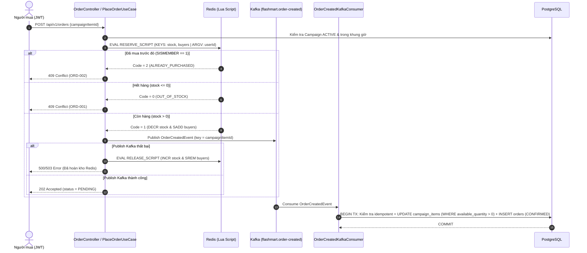

# FlashMart-API

Hệ thống Backend RESTful API cho nghiệp vụ **Flash Sale chịu tải cao (High-Concurrency Flash Sale)**, giải quyết triệt để bài toán **bán vượt tồn kho (Overselling)** và **mua trùng (Duplicate Purchase)** bằng **Redis Atomic Lua Script** kết hợp kiến trúc hướng sự kiện (**Apache Kafka Event-Driven**) và **PostgreSQL**.

---

## 1. Kiến trúc & Luồng Đặt Hàng (System Architecture)

Dự án tuân thủ **Clean / Hexagonal Architecture nhẹ** gồm 3 tầng tách biệt:
- `domain`: Thực thể nghiệp vụ (`User`, `Product`, `Campaign`, `CampaignItem`, `Order`), Port interfaces (`*Repository`, `FlashSaleInventoryPort`, `TokenGenerator`, `OrderEventPublisher`), Domain Events & Exceptions. Hoàn toàn độc lập khỏi framework.
- `usecase`: Các Use Case interfaces và `*Impl` điều phối luồng nghiệp vụ.
- `infrastructure`: Web Controllers, DTOs, `GlobalExceptionHandler`, JPA Entities/Repositories/Adapters, Redis Lua Adapter, Kafka Producer/Consumer, JWT Security.

### Sơ đồ luồng đặt hàng Flash Sale (Mermaid)



---

## 2. Công nghệ sử dụng (Tech Stack)

| Thành phần | Công nghệ & Phiên bản |
|---|---|
| Ngôn ngữ & Framework | **Java 21**, **Spring Boot 4.1.1** |
| Cơ sở dữ liệu & Migration | **PostgreSQL 17**, **Spring Data JPA (Hibernate 7)**, **Flyway** (`V1`, `V2`) |
| Bộ nhớ đệm & Chống Oversell | **Redis 7** (Lettuce, Atomic Lua Scripts) |
| Message Broker | **Apache Kafka 4.3.1 (KRaft)** (`spring-boot-starter-kafka`, Retry + Dead-Letter Topic) |
| Bảo mật | **Spring Security 7**, **JWT (`jjwt 0.12.6`)**, **BCrypt**, Method Security (`@PreAuthorize`) |
| Giám sát | **Spring Boot Actuator** (`/actuator/health`, `/actuator/info`) |
| Kiểm thử | **JUnit 5**, **Mockito**, **MockMvc**, **Testcontainers 2.0.5** (PostgreSQL, Redis, Kafka), **Awaitility** |

---

## 3. Bảng tổng hợp API (API Reference)

| Method | Path | Quyền | Request Body / Params | Response chính |
|---|---|---|---|---|
| `POST` | `/api/v1/auth/register` | Public | `{username, email, password}` | `200 OK` `{jwt}` (Trùng email: `409 AUTH-001`, trùng username: `409 AUTH-002`) |
| `POST` | `/api/v1/auth/login` | Public | `{email, password}` | `200 OK` `{jwt}` (Sai thông tin: `401 AUTH-401`) |
| `GET` | `/api/v1/products` | Public | `?page=0&size=20` | `200 OK` `PagedResult<ProductResponse>` |
| `GET` | `/api/v1/products/{id}` | Public | - | `200 OK` `ProductResponse` (`404 RES-404` nếu không tồn tại) |
| `POST` | `/api/v1/products` | `ADMIN` | `{name, description, originalPrice, generalStock}` | `201 Created` `ProductResponse` + Header `Location` |
| `DELETE` | `/api/v1/products/{id}` | `ADMIN` | - | `204 No Content` |
| `POST` | `/api/v1/campaigns` | `ADMIN` | `{name, startTime, endTime}` | `201 Created` `CampaignResponse` (`status = UPCOMING`) |
| `POST` | `/api/v1/campaigns/{id}/items` | `ADMIN` | `{productId, flashSalePrice, totalQuantity}` | `201 Created` `CampaignItemResponse` (`availableQuantity = totalQuantity`) |
| `PATCH` | `/api/v1/campaigns/{id}/status` | `ADMIN` | `{status}` (`UPCOMING` -> `ACTIVE` -> `ENDED`) | `200 OK` `CampaignResponse` (Khi `ACTIVE`: warm-up tồn kho lên Redis) |
| `POST` | `/api/v1/campaigns/reconcile` | `ADMIN` | - | `200 OK` `{"reconciledItems": n}` (Đồng bộ lại Redis từ DB) |
| `GET` | `/api/v1/campaigns/active` | Public | - | `200 OK` `List<CampaignResponse>` kèm danh sách items |
| `POST` | `/api/v1/orders` | `USER` / `ADMIN` | `{campaignItemId}` (`userId` lấy từ JWT) | `202 Accepted` `{eventId, userId, campaignItemId, status: "PENDING", requestedAt}` |
| `GET` | `/api/v1/orders/me` | `USER` / `ADMIN` | - | `200 OK` `List<OrderResponse>` |
| `GET` | `/api/v1/orders/{id}` | Chủ đơn / `ADMIN` | - | `200 OK` `OrderResponse` (`403 AUTH-403` nếu không phải chủ đơn/ADMIN) |
| `POST` | `/api/v1/orders/{id}/cancel` | Chủ đơn / `ADMIN` | - | `200 OK` `OrderResponse` (`status = CANCELLED`, hoàn kho DB & Redis) |
| `GET` | `/actuator/health` | Public | - | `200 OK` `{"status": "UP"}` |

---

## 4. Các quyết định thiết kế quan trọng (Design Decisions)

1. **Vì sao dùng Redis Lua Script thay vì `GET` rồi `DECR` từ ứng dụng?**
   - Nếu kiểm tra tồn kho (`GET`), kiểm tra đã mua (`SISMEMBER`), trừ kho (`DECR`) và ghi nhận người mua (`SADD`) bằng nhiều lệnh rời rạc, dưới tải hàng nghìn request đồng thời sẽ xảy ra **Race Condition (TOCTOU)**.
   - Đóng gói cả 4 bước vào **1 Lua script duy nhất** (`RedisFlashSaleInventoryAdapter`) đảm bảo Redis thực thi **hoàn toàn tuần tự và nguyên tử (atomic)** trong một bước duy nhất, không cần tới distributed lock nặng nề.
2. **Vì sao kết hợp Kafka + Idempotent Consumer + Conditional SQL Update?**
   - Redis chặn 90%+ lưu lượng vượt tồn kho ngay trên RAM, sau đó đẩy sự kiện sang Kafka để làm phẳng đỉnh tải (load leveling) trước khi ghi xuống PostgreSQL.
   - Ở tầng DB, consumer luôn thực thi câu lệnh nguyên tử `UPDATE campaign_items SET available_quantity = available_quantity - 1 WHERE id = :id AND available_quantity > 0` kết hợp ràng buộc `CHECK (available_quantity >= 0)` và `UNIQUE (user_id, campaign_item_id)` làm chốt chặn an toàn thứ hai.
   - Consumer được thiết kế **Idempotent**: nếu nhận lại message trùng lặp (do Kafka at-least-once delivery), consumer nhận diện đơn hàng đã tồn tại và bỏ qua an toàn, không trừ kho 2 lần và không gây lỗi lặp vô hạn.
3. **Compensation & Phục hồi khi sự cố (Resilience)**:
   - Nếu trừ kho Redis thành công nhưng gửi message lên Kafka thất bại, `PlaceOrderUseCaseImpl` lập tức gọi `RELEASE_SCRIPT` trên Redis để cộng lại tồn kho và xoá user khỏi SET.
   - Nếu Redis khởi động lại bị mất dữ liệu, `InventoryWarmUpRunner` (khi khởi động), tự động reconcile khi gặp `STOCK_NOT_INITIALIZED`, hoặc endpoint `POST /api/v1/campaigns/reconcile` sẽ nạp lại chính xác `available_quantity` và tập người mua từ PostgreSQL lên Redis.

---

## 5. Hướng dẫn khởi chạy & Kiểm thử

### Chạy toàn bộ hệ thống bằng Docker Compose
```bash
cp .env.example .env
# Chỉnh sửa JWT_SECRET và ADMIN_PASSWORD trong .env nếu cần
docker compose up --build -d
```
Hệ thống sẽ tự động khởi동 PostgreSQL 17, Redis 7, Kafka KRaft 4.3.1 (kèm healthcheck), chạy Flyway migration `V1` & `V2`, và mở cổng `http://localhost:8080`.

### Chạy toàn bộ Unit Test & Integration Test (Testcontainers)
Yêu cầu: JDK 21 và Docker đang chạy.
```bash
./mvnw clean verify
```
Bộ test bao gồm:
- Unit test cho toàn bộ Domain Entities (`User`, `Product`, `Campaign`, `CampaignItem`, `Order`), Controllers và Use Cases.
- Integration test (`FlashSaleIntegrationTest`) sử dụng **Testcontainers** (PostgreSQL + Redis + Kafka thật):
  - Kiểm thử phân quyền RBAC (`401`/`403`).
  - Kiểm thử End-to-End: Đăng ký -> Đăng nhập -> Tạo & Kích hoạt Campaign -> Đặt hàng -> Kafka Consumer ghi DB -> Huỷ đơn hoàn kho.
  - **Kiểm thử chống mua trùng**: 1 user bắn 50 request đồng thời -> đúng 1 đơn thành công.
  - **Kiểm thử chống Oversell**: Tồn kho 100, 1000 user bắn 1000 request đồng thời -> đúng 100 đơn `CONFIRMED`, `available_quantity = 0` (không âm), Redis và DB khớp nhau tuyệt đối.