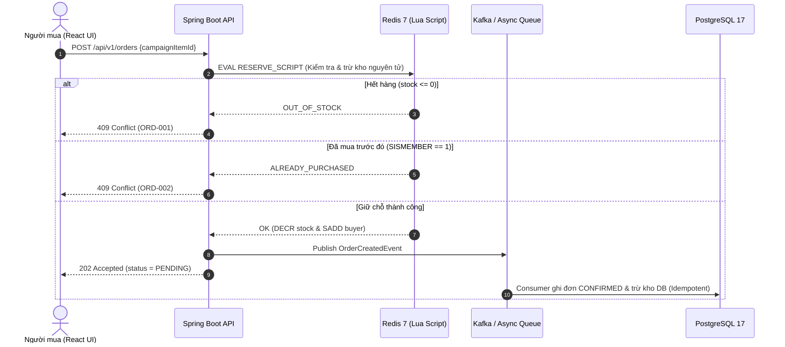

# FlashMart — High-Concurrency Flash Sale System

[](https://github.com/TienThanhUs/High-Concurrency-Flash-Sale-System/actions/workflows/ci.yml)


**FlashMart** là hệ thống thương mại điện tử săn sale giờ vàng (**High-Concurrency Flash Sale**) được thiết kế cho các kịch bản hàng nghìn người dùng tranh mua cùng lúc. Dự án giải quyết triệt để bài toán **bán vượt tồn kho (Overselling)** và **mua trùng (Duplicate Purchase)** bằng **Redis Atomic Lua Script** kết hợp kiến trúc hướng sự kiện **Apache Kafka** và **Clean Architecture**.

---

## 🌐 Bản Demo Trực Tuyến (Live Demo)

- **Giao diện Web (Frontend - Pixel 8-Bit UI):** [https://flashmart-web.onrender.com](https://flashmart-web.onrender.com)
- **Máy chủ REST API (Backend):** [https://flashmart-api.onrender.com/api/v1/products](https://flashmart-api.onrender.com/api/v1/products)

> **Lưu ý:** Bản demo sử dụng gói Cloud miễn phí (Render Free Tier), lần truy cập đầu tiên sau 15 phút không hoạt động có thể mất ~30–40 giây để máy chủ khởi động lại (Cold Start).



---

##  Tính Năng Chính (Features)

- **Chống Oversell & Mua Trùng tuyệt đối:** Thực thi kiểm tra tồn kho, kiểm tra lịch sử mua của từng user và trừ kho trong **1 Redis Lua Script nguyên tử (Atomic)** duy nhất, loại bỏ hoàn toàn lỗi Race Condition (TOCTOU).
- **Xử lý đơn hàng bất đồng bộ (Event-Driven Ordering):** Làm phẳng đỉnh tải (Load Leveling) bằng **Apache Kafka** kèm cơ chế Retry có giới hạn, Dead-Letter Topic (`.dlt`) và tự động hoàn kho Redis (Compensation) nếu hàng đợi gặp sự cố.
- **Tự phục hồi & Đồng bộ tồn kho (Self-Healing & Reconciliation):** Tự động nạp lại tồn kho từ PostgreSQL lên Redis khi khởi động (`InventoryWarmUpRunner`) hoặc khi khóa Redis bị mất (`STOCK_NOT_INITIALIZED`).
- **Bảo mật & Phân quyền RBAC:** Xác thực Stateless bằng **JWT (`jjwt`)** và phân quyền chặt chẽ giữa `USER` (mua hàng, xem/huỷ đơn cá nhân) và `ADMIN` (quản lý sản phẩm, tạo/kích hoạt chiến dịch, đồng bộ kho).
- **Giao diện Pixel Art 8-Bit & CI/CD Tự động:** Giao diện React/TypeScript lấy cảm hứng từ game thùng 8-bit kèm đồng hồ đếm ngược thời gian thực; quy trình CI/CD tự động kiểm thử bằng Testcontainers và đóng gói Docker Image lên GHCR.

---

##  Công Nghệ Sử Dụng (Tech Stack)

| Phân tầng | Công nghệ & Phiên bản |
| :--- | :--- |
| **Backend** | **Java 21**, **Spring Boot 4.1.1**, Spring Security 7, Spring Data JPA (Hibernate 7), Validation, Actuator |
| **Database & Cache** | **PostgreSQL 17**, **Flyway Migration**, **Redis 7** (Lettuce Client + Atomic Lua Scripts) |
| **Message Broker** | **Apache Kafka 4.3.1 (KRaft)** + Fallback In-Memory Async Publisher cho môi trường Cloud miễn phí |
| **Frontend** | **React 18**, **TypeScript 5.7**, **Vite 6**, **Tailwind CSS 3.4**, Axios, React Router v6 |
| **Testing & Benchmark** | **JUnit 5**, **Mockito**, **Testcontainers 2.0** (Postgres, Redis, Kafka), **Awaitility**, **Grafana k6** |
| **DevOps & Cloud** | **Docker & Docker Compose**, **GitHub Actions (CI/CD)**, **GHCR (`ghcr.io`)**, Render, Neon, Upstash |

---

##  Cấu Trúc Thư Mục (Project Structure)

```text
FlashMart-API/
├── .github/workflows/
│   └── ci.yml                  # CI/CD Pipeline: Lint, Testcontainers & Push Docker Image lên GHCR
├── backend-source/             # Backend RESTful API (Clean / Hexagonal Architecture)
│   ├── src/main/java/.../
│   │   ├── domain/             # Entities, Repository Ports, Domain Events & Exceptions (Độc lập framework)
│   │   ├── usecase/            # Business Use Cases (PlaceOrder, ProcessOrderCreatedEvent, Reconcile...)
│   │   └── infrastructure/     # Web Controllers, JPA Adapters, Redis Lua Adapter, Kafka, JWT Security
│   ├── src/main/resources/
│   │   ├── db/migration/       # Flyway SQL Migrations (V1__init_schema.sql, V2__seed_data.sql)
│   │   └── application.yml     # Cấu hình ứng dụng theo biến môi trường & profiles (dev/prod)
│   ├── src/test/java/          # Unit Tests & FlashSaleIntegrationTest (Testcontainers)
│   ├── k6/                     # Kịch bản kiểm thử chịu tải (Load Testing) bằng Grafana k6
│   ├── Dockerfile              # Multi-stage Docker build (Maven JDK 21 -> Eclipse Temurin JRE 21)
│   └── docker-compose.yml      # Khởi chạy trọn bộ PostgreSQL 17 + Redis 7 + Kafka 4.3 + Spring Boot API
└── frontend-source/            # Giao diện người dùng & trang Quản trị (React + TypeScript + Vite)
    ├── src/
    │   ├── components/         # Hệ thống Pixel UI Components (PixelCard, PixelButton, HuntSaleModal...)
    │   ├── pages/              # HomePage, ProductsPage, OrdersPage, AdminPage, LoginPage, RegisterPage
    │   └── services/api/       # Axios Client, JWT Interceptors & API Services
    └── scripts/
        └── seed.mjs            # Script tự động nạp 12 sản phẩm mẫu & kích hoạt chiến dịch Flash Sale
```

---

##  Cài Đặt (Installation)

### 1. Yêu cầu môi trường (Prerequisites)
- **Docker** & **Docker Compose** (Khuyên dùng để chạy nhanh toàn bộ hạ tầng).
- **JDK 21** (Eclipse Temurin) — nếu muốn chạy hoặc phát triển Backend trực tiếp.
- **Node.js >= 20** & **npm** — để chạy giao diện Frontend và script nạp dữ liệu mẫu.

### 2. Các bước cài đặt (Chép vào là chạy)

```bash
# 1. Clone dự án về máy
git clone https://github.com/TienThanhUs/High-Concurrency-Flash-Sale-System.git
cd High-Concurrency-Flash-Sale-System

# 2. Khởi chạy Backend + PostgreSQL 17 + Redis 7 + Kafka 4.3 bằng Docker Compose
cd backend-source
cp .env.example .env
docker compose up --build -d

# 3. Cài đặt và khởi chạy giao diện Frontend (mở cửa sổ Terminal mới)
cd ../frontend-source
npm ci
npm run dev
```

Sau khi chạy xong:
- **Backend API:** `http://localhost:8080`
- **Frontend UI:** `http://localhost:5173`

---

##  Cấu Hình (Configuration)

Backend sử dụng biến môi trường thông qua file [`backend-source/.env.example`](file:///Users/macos/Desktop/REPO/FlashMart-API/backend-source/.env.example) và [`application.yml`](file:///Users/macos/Desktop/REPO/FlashMart-API/backend-source/src/main/resources/application.yml):

| Biến môi trường | Giá trị mặc định (Local) | Mô tả |
| :--- | :--- | :--- |
| `SPRING_PROFILES_ACTIVE` | `dev` | Hồ sơ cấu hình (`dev` hoặc `prod`) |
| `DB_URL` | `jdbc:postgresql://localhost:5432/flash-mart` | Chuỗi kết nối JDBC tới PostgreSQL |
| `DB_USERNAME` / `DB_PASSWORD` | `shop` / `shop` | Tài khoản truy cập PostgreSQL |
| `REDIS_HOST` / `REDIS_PORT` | `localhost` / `6379` | Địa chỉ máy chủ Redis |
| `REDIS_PASSWORD` / `REDIS_SSL` | *(trống)* / `false` | Mật khẩu và bật/tắt TLS (dùng cho Upstash/Cloud Redis) |
| `KAFKA_ENABLED` | `true` | Đặt `false` nếu chạy trên Cloud miễn phí không có Kafka |
| `KAFKA_BOOTSTRAP_SERVERS` | `localhost:9092` | Địa chỉ máy chủ Apache Kafka |
| `JWT_SECRET` | *(chuỗi >= 32 ký tự)* | Khóa bí mật ký JWT HMAC-SHA256 |
| `ADMIN_USERNAME` | `adminUser` | Tên tài khoản Admin khởi tạo tự động (tối thiểu 8 ký tự) |
| `ADMIN_EMAIL` / `ADMIN_PASSWORD` | `admin@flashmart.com` | Email và mật khẩu tài khoản Admin mặc định |

Đối với **Frontend**, có thể cấu hình biến `VITE_API_BASE_URL` (mặc định ở chế độ dev dùng Vite Proxy `/api/v1` trỏ về `http://localhost:8080`).

---

##  Cách Sử Dụng (Usage)

### 1. Nạp dữ liệu mẫu tự động (12 sản phẩm + 1 Chiến dịch Flash Sale đang mở)
Khi Backend đang chạy, mở Terminal tại thư mục `frontend-source` và chạy:

```bash
cd frontend-source
ADMIN_EMAIL="admin@flashmart.com" ADMIN_PASSWORD="your-admin-password" npm run seed
```

### 2. Ví dụ gọi API trực tiếp bằng `curl`

**Bước 1 — Đăng ký tài khoản người mua & lấy JWT Token:**
```bash
curl -X POST http://localhost:8080/api/v1/auth/register \
  -H "Content-Type: application/json" \
  -d '{
    "username": "flashbuyer01",
    "email": "buyer01@flashmart.com",
    "password": "Password123!"
  }'
```

**Bước 2 — Xem các chiến dịch Flash Sale đang diễn ra (`ACTIVE`):**
```bash
curl -s http://localhost:8080/api/v1/campaigns/active
```

**Bước 3 — Đặt mua sản phẩm Flash Sale (`202 Accepted`):**
```bash
curl -X POST http://localhost:8080/api/v1/orders \
  -H "Authorization: Bearer <JWT_TOKEN_CỦA_BẠN>" \
  -H "Content-Type: application/json" \
  -d '{
    "campaignItemId": "<UUID_CỦA_CAMPAIGN_ITEM>"
  }'
```

---

##  Tài Liệu API / Endpoints

| Method | Endpoint | Quyền | Mô tả & Mã phản hồi chính |
| :--- | :--- | :--- | :--- |
| `POST` | `/api/v1/auth/register` | Public | Đăng ký tài khoản mới (`200 OK` trả về `{jwt}`; trùng email: `409 AUTH-001`) |
| `POST` | `/api/v1/auth/login` | Public | Đăng nhập nhận JWT (`200 OK` `{jwt}`; sai thông tin: `401 AUTH-401`) |
| `GET` | `/api/v1/products` | Public | Lấy danh sách sản phẩm phân trang `?page=0&size=20` (`200 OK`) |
| `GET` | `/api/v1/products/{id}` | Public | Xem chi tiết 1 sản phẩm (`200 OK` hoặc `404 RES-404`) |
| `POST` | `/api/v1/products` | `ADMIN` | Tạo sản phẩm mới (`201 Created`) |
| `DELETE` | `/api/v1/products/{id}` | `ADMIN` | Xoá sản phẩm (`204 No Content`) |
| `GET` | `/api/v1/campaigns/active` | Public | Danh sách chiến dịch đang `ACTIVE` kèm các mặt hàng Flash Sale |
| `POST` | `/api/v1/campaigns` | `ADMIN` | Tạo chiến dịch Flash Sale mới (`201 Created`, mặc định `UPCOMING`) |
| `POST` | `/api/v1/campaigns/{id}/items` | `ADMIN` | Thêm sản phẩm với giá sale & số lượng giới hạn vào chiến dịch (`201 Created`) |
| `PATCH` | `/api/v1/campaigns/{id}/status` | `ADMIN` | Chuyển trạng thái chiến dịch (`ACTIVE` sẽ tự động warm-up tồn kho lên Redis) |
| `POST` | `/api/v1/campaigns/reconcile` | `ADMIN` | Đồng bộ lại tồn kho và danh sách người mua từ PostgreSQL lên Redis (`200 OK`) |
| `POST` | `/api/v1/orders` | `USER` | Đặt mua mặt hàng Flash Sale (`202 Accepted`; hết hàng: `409 ORD-001`; mua trùng: `409 ORD-002`; chưa mở: `409 ORD-003`) |
| `GET` | `/api/v1/orders/me` | `USER` | Xem danh sách đơn hàng của bản thân (`200 OK`) |
| `POST` | `/api/v1/orders/{id}/cancel` | Chủ đơn / `ADMIN` | Huỷ đơn hàng, hoàn lại tồn kho trên cả PostgreSQL và Redis (`200 OK`) |

---

##  Hướng Dẫn Chạy Test (Testing & Benchmarks)

### 1. Chạy Unit Tests (Không cần bật Docker)
Kiểm thử toàn bộ logic Domain Entities (`User`, `Product`, `Campaign`, `Order`), Use Cases và Web Controllers:

```bash
cd backend-source
./mvnw test -Dtest="*Test,!*IntegrationTest" -B
```

### 2. Chạy Toàn Bộ Unit & Integration Tests với Testcontainers (Yêu cầu bật Docker)
Tự động khởi tạo container **PostgreSQL 17**, **Redis 7** và **Apache Kafka 4.3.1** thật để kiểm thử:
- Luồng End-to-End (Đăng ký $\rightarrow$ Tạo Campaign $\rightarrow$ Đặt hàng $\rightarrow$ Kafka Consumer ghi DB $\rightarrow$ Huỷ đơn hoàn kho).
- **Chống mua trùng:** 1 người dùng bắn **50 request đồng thời** $\rightarrow$ đúng 1 đơn thành công, 49 request bị chặn với mã `ORD-002`.
- **Chống bán lố (Anti-Oversell):** Tồn kho 100 sản phẩm, **1,000 người dùng bắn 1,000 request đồng thời** $\rightarrow$ đúng 100 đơn `CONFIRMED`, 900 request nhận `ORD-001`, tồn kho Redis & DB khớp nhau tuyệt đối bằng `0` (không âm).

```bash
cd backend-source
./mvnw clean verify -B
```

### 3. Kiểm tra Lint & Build cho Frontend
```bash
cd frontend-source
npm run lint
npm run build
```

### 4. Kiểm thử chịu tải (Load Testing) với Grafana k6
```bash
cd backend-source/k6
k6 run flash-sale-oversell-test.js
```

---

## 📄 License

Dự án được phân phối dưới giấy phép **MIT License**. Bạn được tự do sử dụng, chỉnh sửa và phân phối lại mã nguồn cho mục đích học tập hoặc thương mại.
